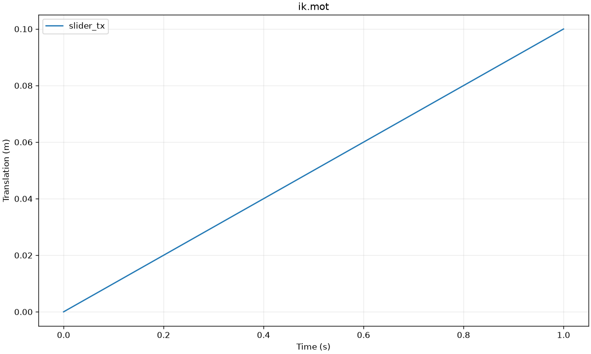

# v0.4 工作流：47 个工具

支持 Windows 11 x64，保留原有 22 工具，新增 25 工具。版本与实际测试见
[VERIFIED](../VERIFIED.md)。以下参数都是 MCP 工具调用的 JSON 示例；把示例路径替换为
已授权的输入目录或本服务生成的结果路径。

## 任务进度、取消、历史和保存点

长分析用 submit_analysis；支持 ik、id、muscle_analysis、static_optimization、scale、
joint_reaction、moco、ik_quality。parameters 对应同步工具参数，timeout_seconds 为整个任务的
1–600 秒时限。两项任务可并行，最多 20 项运行/排队任务。

~~~json
{"workflow":"ik","parameters":{"model_path":"E:/Data/slider.osim","marker_path":"E:/Data/slider.trc"}}
~~~

返回 job_id 后调用 get_job_status。progress.phase 和 native_log_tail 来自实际阶段/求解日志，
不估算没有依据的百分比。任务状态为 queued、preparing、running、publishing、completed、
failed、cancelled 或 interrupted。list_jobs 可在 MCP 重启后读取历史。

cancel_job 会停止整个 Windows Job Object 进程树，并等待进程退出。
只有确认退出才返回 cancelled=true。若结果已先提交，则返回 completed。
取消前的输出留在私有临时区，取消任务不会发布完整结果；正常结果提交使用独立新目录。
MCP 异常退出时，Windows 关闭作业句柄并结束其原生子进程；历史会识别中断状态。
当前任意 Python 脚本仍使用常驻会话和独立超时，不由 submit_analysis 调度。

create_checkpoint 保存模型 XML、坐标姿态、时间、版本及哈希；list_checkpoints 和
restore_checkpoint 可跨 MCP 重启使用。恢复前先保存当前模型作为恢复点，校验哈希并原生初始化。
跨运行时恢复须显式 allow_version_mismatch=true；它不表示所有版本/组件兼容。
任意 Python 变量、文件和网络副作用不属于模型保存点。

undo_model_edit/redo_model_edit 支持最近 10 次结构化参数编辑，expected_revision 防止过期撤销。
任意脚本和模型加载会清除这一内存撤销历史。GUI 参数同步可设 sync_gui=true。

## API 查询与错误定位

- get_api_documentation：搜索安装版本的符号，或查询 Model.scale、Body.set_mass 等公开成员。
  部分 SWIG 方法缺少文档字符串，会如实返回 binding_doc_available=false 及源码参考。
- list_model_components：按路径文本/类名过滤并分页列出实际原生组件。
- get_component_details：读取绝对组件路径的属性、类型和 socket 连接路径。
- check_opensim_code：静态检查 Python 语法和直接 OpenSim 符号，返回行列，不执行提交的代码。
  它不推断所有动态类型或证明模型/求解问题有效。
- diagnose_opensim_error：从错误文本定位文件/行，并给出针对配置、连接、单位或求解器的提示。
  实际脚本异常另返回 diagnostics 的行号与源代码行。

~~~json
{"symbol":"Model.scale","limit":30}
~~~

~~~json
{"component_path":"/bodyset/block"}
~~~

## 客户端图像、曲线与 GUI 编辑

plot_motion_result 输入 .mot/.sto、1–8 个列名和明确的纵轴单位说明；返回实际 MCP PNG 图像，
同时保存 PNG/SVG 和来源哈希。长序列采用分桶最小/最大值抽样，保留尖峰。
render_model 根据 API 当前原生状态绘制身体坐标系骨架和标记点，单位为米，不加载表面网格。
read_image 可把授权 PNG 重新返回客户端。图像限 8 MiB、1600 万像素。
绘图在单独受控进程完成，避免 NumPy/Matplotlib 原生导入阻塞 MCP 通信线程。

get_gui_selection 读取实际 Navigator 选择；select_gui_component 可选择原生组件并读回确认。
undo_gui_pose 撤销最近 20 次桥接坐标编辑；模型或姿态变化后会拒绝过期撤销。
capture_gui_image 返回 OpenSim Swing 窗口 PNG；嵌入的硬件加速 3D/浏览器区域可能无法被
Swing 绘制捕获。需要模型姿态图时先 pull，再用 render_model。任意 GUI 操作/脚本不属于撤销范围。

GUI 与 API 仍是独立模型会话，使用 sync_gui_model 显式 pull/push。
升级 Python 桥接脚本后重启一次 GUI；已安装的启动插件会自动载入新版桥接。

## 缩放

scale_model 调用原生 Model.scale，支持明确的身体 XYZ 因子，或静态 TRC 中标记对的平均距离比。
每个 measurement 声明 body、axes、marker_pairs；同一身体/轴不能重复指定。
因子限制 [0.2,5]，质量须为正。输出质量误差、每对标记的距离误差、实验距离变异系数，
并重新载入生成模型验证初始化。max_measurement_error_m 可设置自己的误差门槛。

~~~json
{"model_path":"E:/Data/slider.osim","subject_mass_kg":2,
 "static_marker_path":"E:/Data/slider_scale_static.trc",
 "measurements":[{"body":"block","axes":["y"],"marker_pairs":[["M1","M2"]]}],
 "max_measurement_error_m":0.000001}
~~~

该流程缩放身体、质量/惯量及随身体缩放的组件；不执行 MarkerPlacer 的虚拟标记重新定位。
不自动猜测人体测量参数、标记对应关系或单位。

## 关节反力

run_joint_reaction 需要完整坐标、明确的外力或 no_external_loads=true，以及 joint_names、
on_body=child/parent、in_frame=ground/parent/child。含肌肉/执行器时必须提供完整 forces_path，
例如 Static Optimization 的 _force.sto；确需排除它们时显式 ignore_actuators=true。
默认不会把缺失的肌肉力当成已求解。

输出每个关节的力/力矩分量和峰值合力/合力矩；它们是关节结构的合载荷，
不是单块软骨的接触力。输入外力为 N、m、N·m，力表须覆盖分析时间窗。
原生低通滤波可能产生微秒级时间舍入；样本数仍须完全一致，并记录受采样间隔约束的时间误差。

## Moco

run_moco 使用实际 Moco/CasADi。当前结构化配置为固定起止时间、完整状态/控制边界和控制努力目标。
所有模型状态/控制必须显式列出，不自动补充未知边界、目标、接触模型或储备执行器。
状态采用 OpenSim 内部单位，角度为弧度；控制的尺度由执行器定义。
CoordinateActuator 的实际力/力矩为 control × optimal_force，不能把所有控制值统一理解为 N。
本例 optimal_force=1，因此控制值与力的数值相同。
示例见 [moco_problem.json](../examples/moco_problem.json) 和
[moco_slider.osim](../examples/moco_slider.osim)。模型路径作为 model_path 另传入。

质量检查包括原生 success/status、有限目标与轨迹、时间覆盖、状态/控制边界、端点误差。
refine_mesh=true 会加倍网格重新求解，检查目标相对变化是否小于调用者设定的
max_mesh_objective_relative_change。两次求解共同受总时限限制。
当前示例最小控制努力的解析目标为 48；本机粗/细网格结果都符合该值。
MocoTrack、MocoInverse、自定义 goal/path constraints 仍通过可信脚本/API 使用，尚无通用结构化封装。

## IK 标记质量

assess_ik_quality 独立用原生模型重建标记位置，计算总 RMS、最大误差和每标记残差。
max_frames 控制检查样本数，并报告实际检查帧数。
默认要求运动/TRC 时间一致，只允许记录过的序列化舍入；时间网格确有差异时，
显式 interpolation="linear"，限制插值间隔，不外推，并报告插值帧数及时间差。
rms_threshold_m 由调用者决定；不传阈值时不会自动判为科研质量合格。

## 真实数据与 GUI 生命周期回归

regression_human.py 使用本机官方 Gait2354 的 subject01 数据，原始数据只读且哈希核对。
已实测 12 身体、23 坐标、54 肌肉的模型、73 帧测力台 ID、新的 11 帧 IK 和标记残差。
还已实测同一模型 4.6→4.3→4.6 保存/载入，保留计数和总质量；两版本 ID 数值相同。
真实示例的残差如实记录，不以程序运行通过代替生理学结论。

regression_gui_lifecycle.py 使用独立测试配置，验证两次启动自动桥接、进程更换、旧心跳失效，
并通过 MCP 验证 GUI 选择、姿态撤销和 PNG 返回。测试前须准备好官方资源目录，
避免每套新测试配置触发首次安装窗口。

日常 start-gui.ps1 使用项目 state/gui-user 保留偏好及首次启动状态；
模型/脚本资源放在稳定目录，缓存和日志留在 TempRoot。不要把 state、结果、令牌或本机配置上传 GitHub。
